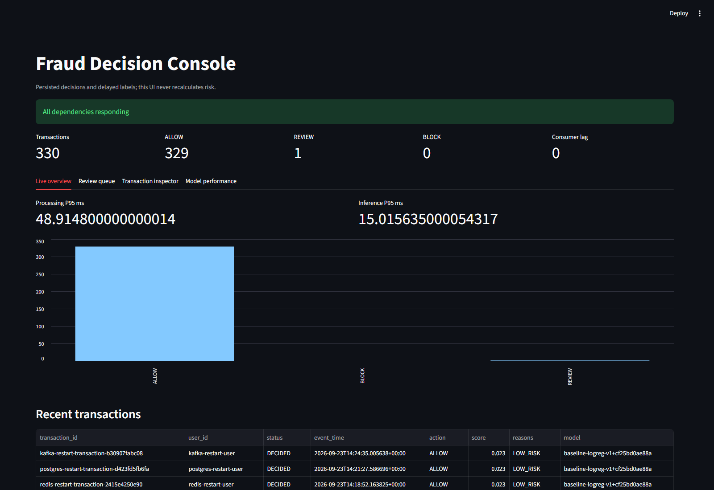
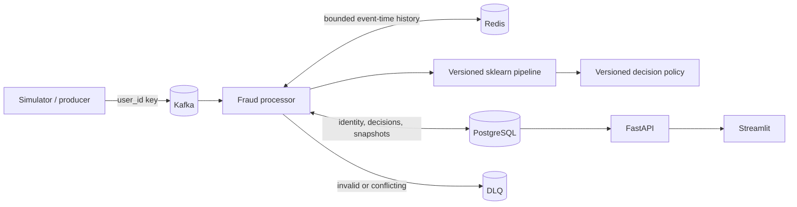

# Real-Time Fraud / Anomaly Detection Engine

A local, production-style reference implementation for event-time fraud features, versioned ML inference, explainable business decisions, delayed labels, review workflows, observability, resilience testing, and drift export.

The system is intentionally honest about its guarantees: Kafka delivery is at least once, Redis is disposable, PostgreSQL is the durable record, and a model score is kept separate from the ALLOW, REVIEW, or BLOCK action.



## Architecture



### Processing contract

1. Validate the immutable v1 event and require the Kafka key to equal `user_id`.
2. Claim `event_id` and `transaction_id` in PostgreSQL under a per-user advisory lock.
3. Rebuild Redis from completed PostgreSQL history when state is absent.
4. Atomically calculate the pre-event feature snapshot and insert the event once.
5. Run the compatible model within a deadline.
6. Apply the separately versioned decision policy.
7. Commit the transaction, feature snapshot, exact versions, score or explicit failure, action, and reasons in PostgreSQL.
8. Commit the Kafka offset only after that terminal write. Invalid input is committed only after the DLQ publish is acknowledged.

This sequence provides one durable terminal decision per transaction under replay, conditional on PostgreSQL durability and eventual dependency recovery. It does not provide exactly-once execution across Kafka, Redis, and PostgreSQL.

## Implemented checkpoints

| Range | Capability |
|---|---|
| 0–3 | Architecture, scaffold, deterministic fraud simulator, chronological baseline training |
| 4–7 | Kafka ingestion, offline/online event-time features, inference compatibility, decision policy |
| 8–10 | Idempotent end-to-end processor, resilience policy, query and human-review API |
| 11–13 | Delayed-label evaluation, Streamlit dashboard, structured logs and Prometheus metrics |
| 14–16 | Performance harness, 22 failure experiments, versioned drift export |
| 17–18 | Demo scripts, CI, interview guide, broad architecture and invariant audit |

Checkpoint records are under [`docs/phases`](docs/phases). The final review is [`docs/final-architecture-review.md`](docs/final-architecture-review.md).

## Local requirements

- Windows PowerShell
- Python 3.12 or newer
- Docker Desktop
- About 2 GB available memory for PostgreSQL, Redis, and the single Kafka broker

The project maps PostgreSQL to host port **5433** because port 5432 may be occupied by a local Windows PostgreSQL service. Container data is bind-mounted under `.local/` on D:.

## Install

```powershell
python -m venv .venv
.\.venv\Scripts\python.exe -m pip install -e '.[dev,dashboard]'
```

Regenerate the deterministic dataset and model when needed:

```powershell
.\.venv\Scripts\python.exe -m fraud_engine.simulator --seed 17 --users 2000 --transactions 200000
.\.venv\Scripts\python.exe -m fraud_engine.training --data data/generated --output artifacts/fraud-v2
```

## Run the demo

```powershell
.\scripts\start-demo.ps1
```

This starts PostgreSQL, Redis, Kafka, applies Alembic migrations, creates topics idempotently, and launches the processor, API, and dashboard as hidden local processes. Logs and exact PIDs are stored under `.tmp/`.

Open:

- Dashboard: `http://127.0.0.1:8501`
- OpenAPI: `http://127.0.0.1:8000/docs`
- Prometheus text: `http://127.0.0.1:8000/metrics`

Publish generated traffic:

```powershell
.\.venv\Scripts\fraud-produce.exe --limit 100
```

Stop application processes while retaining infrastructure:

```powershell
.\scripts\stop-demo.ps1
```

Stop applications and Compose services:

```powershell
.\scripts\stop-demo.ps1 -StopInfrastructure
```

## Run components manually

```powershell
docker compose up -d postgres redis kafka
.\.venv\Scripts\python.exe -m alembic upgrade head
.\.venv\Scripts\fraud-init-topics.exe
```

Use separate shells for these processes:

```powershell
.\.venv\Scripts\fraud-process.exe
.\.venv\Scripts\uvicorn.exe fraud_engine.api:app --host 127.0.0.1 --port 8000
.\.venv\Scripts\fraud-dashboard.exe --server.address 127.0.0.1 --server.port 8501
```

`fraud-consume-probe` uses a separate validation-only consumer group. It does not write decisions and must not be used as the production processor.

## API

| Method and route | Purpose |
|---|---|
| `GET /transactions` | Recent persisted transactions and decisions |
| `GET /transactions/{id}` | Raw event, source coordinates, status, attempts, timestamps |
| `GET /decisions/{id}` | Exact snapshot, versions, score/status, action, reasons |
| `GET /users/{id}/risk-history` | Bounded persisted user history |
| `GET /reviews` | Review queue and existing labels |
| `POST /reviews/{id}/label` | Idempotent FRAUD, NOT_FRAUD, or UNSURE submission |
| `GET /metrics/summary` | DB counts, throughput, latency percentiles, lag, fallbacks |
| `GET /metrics/model-performance` | Matured-label model and action evaluation |
| `GET /metrics/runtime` | In-process bounded counters and samples |
| `GET /metrics` | Prometheus exposition |
| `GET /monitoring/export` | Versioned drift-monitoring records |
| `GET /system/health` | PostgreSQL, Redis, Kafka, and model status |

The local review endpoint accepts a caller-supplied reviewer ID. A production deployment must obtain analyst identity from authentication middleware rather than trusting this field.

Review queue reads and label writes require the `X-Review-API-Key` header. Set
`FRAUD_REVIEW_API_KEY` through the environment or a local uncommitted `.env`; never commit real
keys. The API fails closed when the key is not configured. The dashboard reads the same environment
variable and forwards the header.

## Evaluation and monitoring

Import only labels whose simulated availability time has passed and write an evaluation report:

```powershell
.\.venv\Scripts\fraud-evaluate.exe --labels data/generated/labels.csv --output artifacts/evaluation/latest.json
```

UNSURE and unmatured labels are excluded. Model metrics use the versioned score threshold. Decision outcomes are reported separately so a policy change is not mislabeled as a model change.

Export monitoring records:

```powershell
.\.venv\Scripts\fraud-export-monitoring.exe --output artifacts/monitoring/export.jsonl
```

The export carries feature, model, and policy versions and reveals a label only after `available_at`. See [`docs/integration-with-drift-monitoring.md`](docs/integration-with-drift-monitoring.md).

## Performance

Run all bounded local scenarios:

```powershell
.\scripts\run-performance.ps1 -Events 50
```

The direct harness measures processor claim through terminal PostgreSQL commit; it excludes Kafka transport and reports Kafka lag separately.

| Scenario | Events/s | End-to-end p50 ms | End-to-end p95 ms | Dominant injected delay |
|---|---:|---:|---:|---|
| normal | 19.47 | 38.51 | 62.25 | none |
| burst | 19.55 | 39.65 | 56.77 | concentrated event times |
| slow model | 11.57 | 70.92 | 90.34 | +20 ms predictor wrapper |
| slow DB | 10.37 | 78.06 | 101.33 | +20 ms before commit |
| slow Redis | 10.77 | 79.71 | 96.25 | +20 ms feature wrapper |

These results describe one developer machine and a synchronous processor. They are not capacity promises. Raw reports are in `artifacts/performance/`; methodology is in [`docs/phases/phase-14-performance.md`](docs/phases/phase-14-performance.md).

A later v2 run over 500 live processor-path events measured 25.19 decisions/s, 33.61 ms p50, and
44.92 ms p95. Kafka accepted a 1,000-event burst at 4,157.86 events/s, which immediately created
947 events of consumer lag; the single synchronous processor subsequently drained it to zero. The
system therefore tolerates a high-rate burst but does not sustain 500–1,000 decisions/s.

## Verify

```powershell
.\.venv\Scripts\ruff.exe format --check .
.\.venv\Scripts\ruff.exe check .
.\.venv\Scripts\python.exe -m compileall -q src
.\.venv\Scripts\python.exe -m pytest -q
```

Run the real-service suite after Compose is healthy:

```powershell
$env:FRAUD_INTEGRATION = '1'
.\.venv\Scripts\python.exe -m pytest -q tests/integration/test_live_stack.py
Remove-Item Env:FRAUD_INTEGRATION
```

## Measured model quality

Synthetic v2 contains 200,000 transactions at 1.77% fraud prevalence. On the untouched
chronological test split, the serving balanced logistic model reached **0.647 PR-AUC** and
**83.4% recall in an exact 5% review budget**. HistGradientBoosting reached 0.738 PR-AUC and 88.6%
recall as a challenger. The serving threshold was selected on validation only. Bootstrap intervals,
feature diagnostics, the hidden-generator ceiling, cost analysis, and calibration results are in
[`artifacts/fraud-v2/report.json`](artifacts/fraud-v2/report.json). These are synthetic results, not
claims of production fraud effectiveness.

The balanced logistic score is not well calibrated (test ECE 0.130). It is treated as a ranking
score and a validation-selected policy input, not a literal probability.

## Important limits

- One Kafka broker has no high availability or disk-loss tolerance.
- The processor is synchronous and pauses all assigned partitions while an unresolved valid event retries.
- Redis and PostgreSQL outages delay decisions; callers must treat queued or PENDING events as unresolved.
- Labels are append-only initial submissions; corrections need a separate audited record type.
- Model timeout ignores late results but cannot forcibly terminate arbitrary Python worker code.
- API-key authentication protects the local review surface, but authenticated analyst identity,
  TLS, a secret manager, RBAC, a replicated database, and a deployment orchestrator remain outside
  this local project.

## Documentation map

- Core design: [architecture](docs/architecture.md), [event model](docs/event-model.md), [system invariants](docs/system-invariants.md), [streaming semantics](docs/streaming-semantics.md)
- Data and ML: [feature definitions](docs/feature-definitions.md), [ML methodology](docs/ml-methodology.md), [drift integration](docs/integration-with-drift-monitoring.md)
- Reliability: [failure model](docs/failure-model.md), [failure experiments](docs/failure-experiments.md), [final review](docs/final-architecture-review.md)
- Learning notes: [checkpoints 8–10](docs/learning-guide-checkpoints-08-to-10.md), [checkpoints 11–18](docs/learning-guide-checkpoints-11-to-18.md)
- Presentation preparation: [interview guide](docs/interview-guide.md)
