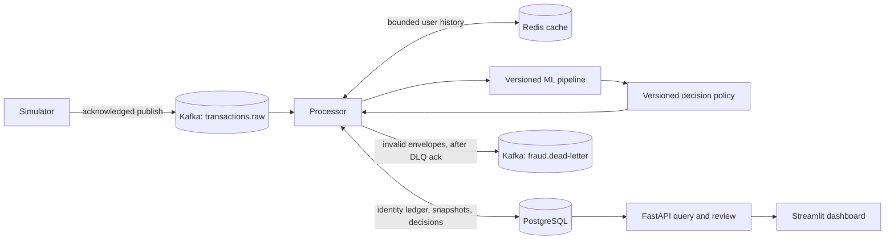
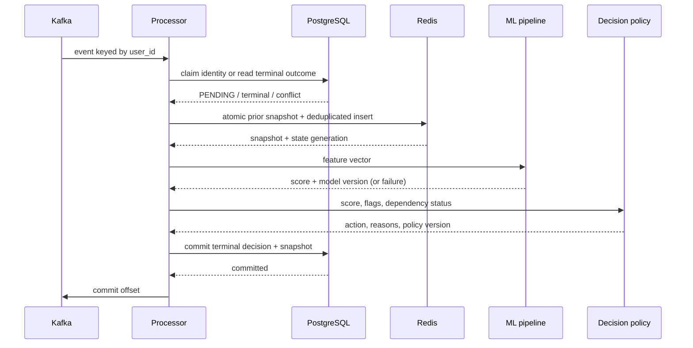
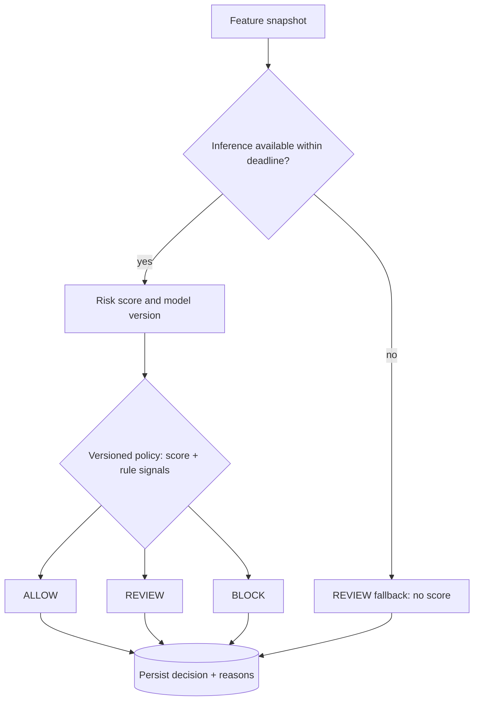

# Architecture (checkpoint 0)

## Scope and boundaries

The simulator creates immutable transaction-created events and publishes them to `transactions.raw`. The processor is the only writer of online feature state and fraud decisions. Redis serves bounded per-user history for low-latency feature calculation. PostgreSQL is the durable identity ledger and record of decisions, event snapshots, processing state, and human labels. The scikit-learn pipeline returns a risk score, never an action. A versioned policy maps score, feature flags, and dependency state to ALLOW, REVIEW, or BLOCK. FastAPI reads decisions and accepts idempotent review labels; Streamlit reads through the API. Neither API nor dashboard recalculates decisions. The local demo accepts a caller-supplied reviewer ID; production authentication and authorization remain outside this deployment.

The initial local deployment is one Kafka KRaft broker, one processor group, one Redis, one PostgreSQL, and optional API/dashboard processes. Docker Compose starts only needed services. Kafka/Redis/PostgreSQL volumes and small retention limits belong on D: where possible. This is a learning deployment, not a high-availability payment authorization service. The producer reports success only after Kafka acknowledges the write; consumers perform asynchronous decisions. Clients must treat a queued event as **pending**, not ALLOW.

## Ownership and transaction boundaries

`event_id` identifies one immutable envelope; `transaction_id` identifies one business transaction. PostgreSQL enforces unique values for both and stores a canonical payload digest. Different payload under an existing event ID, or a new event ID under an existing transaction ID, is a conflict and goes to quarantine; it never rescales an earlier decision. User identity cannot change for a transaction. See [event model](event-model.md).

Before feature work, the processor validates the event and records a `PENDING` claim in a short PostgreSQL transaction. That claim is durable but is **not** a decision. A unique constraint and a per-user **session-level** PostgreSQL advisory lock (or equivalent serialized claim/decision protocol) protect concurrent processors and replay. The lock covers the processing attempt, including feature calculation and final decision commit, across the short claim transaction; a transaction-scoped lock released at claim commit would be insufficient. The implementation must hold one DB connection for the lock and release it in `finally` (or rely on session termination after a crash). Normal Kafka partition assignment also serializes a user, but correctness does not rely solely on a consumer group behaving perfectly during a rebalance.

The processor then uses one atomic Redis operation to read the event-time prior history, return the pre-event feature snapshot, and insert the current immutable event exactly once. The operation stores the snapshot under the event ID for retry. A replay after Redis mutation gets the same snapshot; a replay after Redis loss reconstructs committed prior history from PostgreSQL and recomputes the pending event. The processor scores, applies policy, and commits one final record containing raw event, snapshot, score or explicit inference failure, versions, reasons, timestamps, and outcome. Only then does it commit the Kafka offset. The DB cannot atomically commit with Redis or Kafka; replay plus durable identities closes the relevant crash gaps. Redis updates are never the sole durable record of an accepted event.

The Redis cache is rebuilt from **completed, feature-included** events in PostgreSQL, in arrival/decision sequence, up to the history horizon. Rebuild excludes pending and late events. A cache generation marker and per-user lock prevent using partially rebuilt state. If rebuild fails, normal scoring waits. Retain the durable event ledger long enough for the required replay, audit, and training horizon; do not purge it merely because Redis TTL elapsed. `redis_features.py` implements the atomic Lua operation, and `processing.py` holds a session-level PostgreSQL advisory lock for the full user attempt.

## Decision path

Normal decisions depend on both model risk and explicit signals. In the initial policy, low risk without high-risk signals may ALLOW; intermediate risk or a strong behavioral signal goes to REVIEW; BLOCK needs a high score plus corroborating signals or an explicit hard rule approved for the demo. Thresholds are selected against chronological validation data and review capacity, then versioned. A score is a model estimate, not proof of fraud. Dependency failure produces an explicit REVIEW fallback when the DB is available; it records `inference_status=NOT_RUN` or `FAILED` and no fabricated score. Redis/DB failure instead leaves processing pending and offsets uncommitted; the product cannot issue an ALLOW during that interval.

## Explicit limits

There is no global transaction ordering, exactly-once execution across services, synchronous authorization guarantee, automatic correction of prior decisions when late events arrive, or durable Redis guarantee. An already issued action is immutable; later labels and re-evaluation attach as separate records. The initial design uses per-user features only. Any cross-user/global feature needs a separate aggregation and ordering design.
