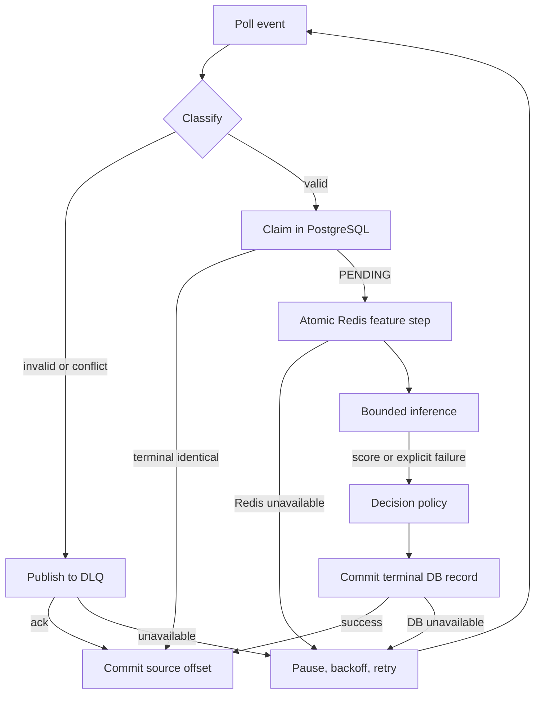

# Failure model and recovery policy

The product issues actions asynchronously. A Kafka acknowledgment means queued, not approved. While a valid event is pending because of dependency failure, a caller must not infer ALLOW. Normal processing requires PostgreSQL and Redis. A model failure can produce a durable REVIEW fallback with no score. A malformed event is quarantined before its offset advances. All retry paths carry source topic/partition/offset, event/transaction IDs when parseable, error class, attempt count, and elapsed time in structured logs and metrics.

| Case | Durable/visible result and recovery |
|---|---|
| 1. Duplicate Kafka event | Same event ID and digest: terminal DB record short-circuits; if still pending, Redis returns the same pre-event snapshot. No second decision or feature insert. |
| 2. Out-of-order event | Partition order is arrival order, not event time. Within allowed lateness, compute against already completed, strictly earlier event-time records. Do not revise old decisions. |
| 3. Late event | Earlier than watermark minus 2 minutes: terminal REVIEW with `LATE_EVENT`, null score, `feature_included=false`; visible in monitoring. Boundary is eligible. |
| 4. Crash before processing | Offset uncommitted; Kafka redelivers. No durable decision is assumed. |
| 5. Crash after Redis update | Event remains PENDING in PostgreSQL. Replay gets saved Redis snapshot; if Redis was lost, rebuild from completed DB history and recompute. Current pending event is excluded from rebuild. |
| 6. Crash after DB persistence | Terminal decision exists. Replay short-circuits before Redis mutation and advances offset. If Redis was lost, next eligible event rebuilds it. |
| 7. DB commit succeeds, offset commit fails | Same as 6. Reprocessing is harmless; Kafka offset is retried. |
| 8. Redis unavailable | Pause assigned partitions and retry; keep offset uncommitted and event PENDING. Do not invent zero-valued features or ALLOW. Recovery rebuilds missing state from DB. |
| 9. PostgreSQL unavailable | Cannot claim identity, check duplicates, or persist action; pause/retry without offset commit. Product shows pending/unavailable, not ALLOW. |
| 10. Kafka unavailable | Producer returns failure/503 after bounded retries and does not claim acceptance. If broker fails during DLQ/offset commit, retry after recovery. Acknowledged records are subject to the single-broker durability limit. |
| 11. Model unavailable/load failure | If feature state and DB are available, persist REVIEW with `MODEL_UNAVAILABLE`, null score/model version and explicit inference status. Do not use an unverified model artifact. |
| 12. Malformed/unsupported event | Publish original bytes or safe reference, source coordinates, and error to DLQ; only then commit source offset. DLQ publication is at least once. Quarantine operators can inspect/replay via a separate audited path. |
| 13. Extremely slow inference | Enforce a bounded deadline. On timeout, persist REVIEW with `MODEL_TIMEOUT`, null score and explicit status; record latency. A worker that continues after timeout must be cancelled or its late result ignored. |
| 14. Human label submitted twice | API uses reviewer submission idempotency key and DB unique constraint on decision ID + submission key. Identical retry returns previous result; conflicting retry is 409. Changing a label requires an explicit correction record, not overwrite. |

Additional conflicts: same `event_id` with altered payload or same `transaction_id` from another event ID cannot replace a decision; record a conflict and quarantine the new delivery. Future timestamps beyond clock-skew tolerance are quarantined before watermark update. A failure between DB claim and feature update leaves a visible PENDING claim. An operator runbook must flag claims older than the processing SLA for replay, and a retention/lag alarm must warn before Kafka can delete unprocessed messages. Single-broker Kafka cannot promise survival of disk/broker loss.

## Retry and crash flow

The Redis/DB/Kafka sequence is not one distributed transaction. The intended guarantee is **one durable terminal decision per transaction under retried delivery**, conditional on PostgreSQL durability and eventual dependency recovery. DLQ records and processing attempts may be duplicated. No guarantee is made that every accepted event finishes within a fixed time during outages. This must be stated in API responses and demos.
