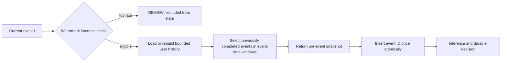

# Feature definitions: `features-v2`

All windows use UTC `event_timestamp`, with lower bound inclusive and current time exclusive: `[t - W, t)`. The current event is excluded. Only previously **arrived and completed, feature-included, unique** transactions for the same user qualify. Equal timestamps do not count as prior even if their Kafka offset is lower. An exact duplicate returns the persisted/saved snapshot and never updates state. An in-bound out-of-order event uses eligible earlier event times already known; it never rewrites a previous decision. Events older than the two-minute watermark tolerance yield a REVIEW fallback, no normal feature vector, and are excluded from future history. A historical replay must use original arrival order.

| Feature | Definition and edge cases | Window / basis | Redis representation |
|---|---|---|---|
| `transaction_count_5m` | Number of prior unique transactions; exactly `t-5m` included | 5m event time | Filter user history sorted set |
| `transaction_count_1h` | Number of prior unique transactions; exactly `t-1h` included | 1h event time | Same sorted set |
| `average_amount_24h` | Arithmetic mean of prior positive minor-unit amounts; `0` when empty | 24h event time | History members + amount hash |
| `has_amount_history_24h` | `1` if 24h mean has at least one member, else `0` | 24h event time | Same history |
| `amount_vs_user_average_24h` | Current amount divided by prior 24h mean; `0` when no history. Ratio is finite and may be clipped only by a versioned preprocessing pipeline. | 24h event time | Same history; current amount is an input, not inserted yet |
| `amount_zscore_24h` | Current amount relative to the prior mean and population standard deviation, clipped to `[-20, 20]`; `0` without nonzero variance | 24h event time | Amounts in shared history |
| `small_transaction_count_5m` | Prior five-minute amounts at or below 25% of the prior 24h mean; supports card-testing detection | 5m / 24h event time | Shared history |
| `unique_devices_24h` | Distinct prior device IDs; count is `0` when empty | 24h event time | Same history + device hash |
| `is_new_device_24h` | `1` if current device is absent from prior 24h history, including cold start; this is **not** lifetime-new | 24h event time | Same history + device hash |
| `device_age_seconds_24h` | Seconds since the current device first appeared in the retained 24h history; `0` for a new device | 24h event time | Same history + device hash |
| `unique_countries_24h` | Distinct prior country codes | 24h event time | Same history + country hash |
| `unique_merchants_24h` | Distinct prior merchant categories | 24h event time | Same history + merchant field |
| `seconds_since_previous_transaction` | Difference from maximum strictly earlier known event time; missing is encoded as `-1` and accompanied by `has_previous_transaction=0` | 24h event time | Same history |
| `has_previous_transaction` | `1` when such a prior event exists, else `0` | 24h event time | Same history |
| `hour_of_day_deviation_24h` | Circular distance in hours from the mean hour of prior history; `0` on cold start | 24h event time | Same history + event hour |

No failed-transaction feature is claimed because v1 events do not carry a payment outcome and those semantics need separate evidence. Currency normalization must be defined before training across currencies; the first dataset/model restricts to INR. Amounts remain precise minor units until conversion to a model vector.

## State and atomicity

For each user, Redis holds a sorted set of immutable transaction IDs scored by event timestamp; a hash/record maps each ID to the amount, device, country, event ID and canonical digest; metadata holds the completed-event watermark and a cache generation. A per-event snapshot key supports replay between Redis mutation and DB commit. One atomic script checks ID/digest, selects strictly earlier history, computes the snapshot, inserts the current event once, and returns the snapshot. Re-entry for the same event returns its original snapshot. The script must not silently replace a different digest. It prunes only entries older than `watermark - (24h + 2m)` and sets an inactivity TTL of at least 26 hours on the whole user cache and snapshot metadata. A cache miss or missing saved snapshot for an uncommitted event triggers a locked rebuild from PostgreSQL completed events before recalculation. Do not score from a partially rebuilt cache or treat a pending Redis entry as completed history.

The atomic script in `src/fraud_engine/redis_features.py` implements v2. Scores are integer UTC **microseconds**, representable exactly in Redis doubles for this project's date range. Score bounds are passed as exact decimal strings. The script prunes entries older than `watermark - (24h + 2m)` before enforcing a 20,000-entry per-user guard. The guard raises an explicit error; it never truncates a current window. Lua over a hot user's entire 24-hour history can still block Redis and needs load measurement. Cache rebuild uses completed PostgreSQL history under the processor's per-user lock.
