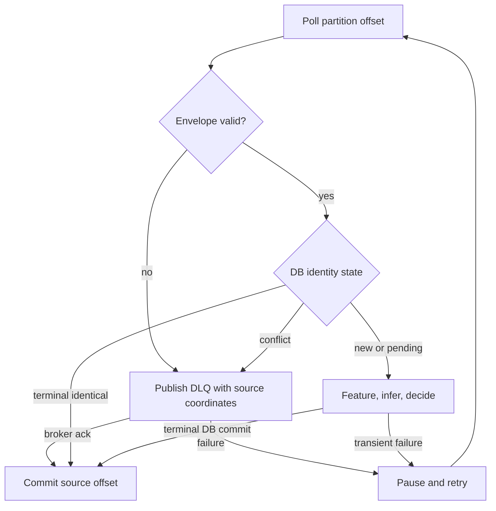

# Streaming semantics

## Topics and key

Initially `transactions.raw` carries immutable v1 transaction-created events. `fraud.dead-letter` exists for malformed, unsupported, or conflicting records with source topic/partition/offset, payload bytes or a safe reference, error code, and attempted processing time. It may contain duplicate quarantine records. `fraud.decisions` is deferred: publishing it reliably requires a PostgreSQL outbox plus relay, because a DB commit and Kafka publish cannot be atomic here. The review queue is a PostgreSQL query, not a separate topic.

Use `user_id` as the Kafka key. All of one user's normal events then go to one partition, and one consumer in a group processes that partition in offset order. This supports per-user sequential state and limits ordinary races. `transaction_id` would distribute each user's events across partitions and break that useful order. A hot user can bottleneck one partition; a later scale-out design might shard user state explicitly, but cannot simply change the key. Global ordering is neither needed nor provided. Features spanning users require a new design. Key and payload `user_id` must agree; missing/mismatched keys are non-retryable invalid envelopes. Repartitioning or changing partition count alters user placement and needs a state migration/rebuild plan.

The `fraud-processor-v1` group uses manual offset commits and disables auto commit. Processing is synchronous. During an unresolved valid event, the prototype pauses all partitions assigned to that consumer so the local pending queue stays bounded while `poll(0)` serves group heartbeats. A consumer restart/rebalance may redeliver work. Kafka preserves offset order **inside a partition**, not event-time order and not cross-partition order. A per-user DB lock and identity constraints remain necessary for rebalance overlap and independent replays. Monitor consumer lag and processing time so a slow model does not exceed poll/session settings unnoticed.

## Commit and retry protocol

1. Validate envelope and key. A non-retryable bad record goes to DLQ; commit source offset only after DLQ broker acknowledgment. If DLQ is down, pause and retry without committing.
2. Claim or inspect event identity in PostgreSQL. An identical terminal event is already processed and its offset can be committed. Conflicting identity goes to quarantine without changing the old transaction.
3. For a new or pending event, calculate features through Redis, infer, decide, and commit a terminal PostgreSQL record. The processor waits for DB commit acknowledgment before advancing the offset.
4. Transient Redis/DB failures, broker errors, and unknown failures retry with bounded exponential backoff and jitter; assigned partitions remain paused while the current valid event is unresolved. There is no finite retry count that silently discards a valid event. Alert after a time budget; operators may explicitly quarantine irrecoverable records.

Committing the highest processed offset in a partition implies all lower offsets have a durable outcome. The processor must never asynchronously finish offset N+1 before N and commit N+1. A commit failure causes redelivery; the DB terminal record and Redis dedup make it safe. A process can crash after Redis update or DB commit; see [failure model](failure-model.md).

## Event time and lateness

The per-user watermark is the maximum `event_timestamp` of **completed, feature-included** events, stored durably or reconstructible from PostgreSQL. Events with `event_timestamp < watermark - 2 minutes` are beyond the prototype's allowed lateness and get a terminal `REVIEW` with reason `LATE_EVENT`, no model score, and `feature_included=false`. The boundary itself is accepted. In-bound out-of-order events are scored against already arrived, completed events whose event time is strictly earlier than their own. Prior decisions are not retroactively changed. Their snapshots therefore reflect *knowledge at decision time*, not a final time-sorted history. Training must replay the same arrival order, not sort away late arrivals.

Future timestamps more than 5 minutes beyond processing clock are quarantined as clock-invalid and do not move the watermark. The two tolerances are configuration values with versions; changing them changes feature/policy behavior and needs a documented migration. Redis cache eviction must retain at least the 24-hour maximum feature window plus the two-minute allowed lateness relative to the watermark. Redis key TTL is an inactivity cleanup, not proof that needed history is absent; cache misses rebuild from PostgreSQL.
